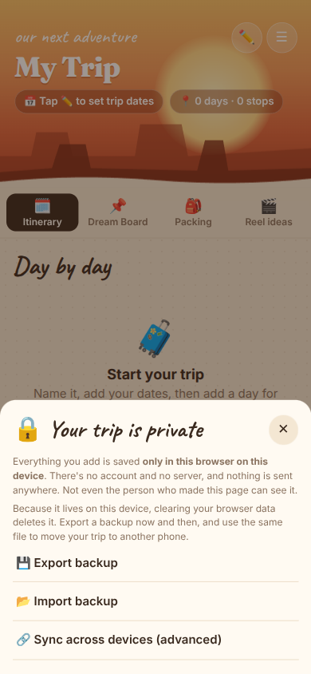

# 🌵 Trip Scrapbook

A phone-first trip planner that feels like a scrapbook. **Your trip stays on your phone. No account, no app. Sync is optional.**

**[▶ Start your trip](https://nidhicj.github.io/arizona-scrapbook/)** (opens a blank scrapbook that's private to your device)

  
  
  

## What it does

- **Opens on today.** On a trip day it scrolls straight to that day and expands the stop that's up next.
- **Day-by-day timeline.** Flights, drives, hikes, meals and photo spots, each with times, map links, notes and photos.
- **Fold everything.** Collapse whole days or single stops so a 5-day trip fits on one screen.
- **⭐ MUST WATCH vs OPTIONAL.** Tag stops so you know what to skip when you're running late.
- **Packing lists per person.** Separate lists for each traveller plus a shared one, with editable categories.
- **Dream board & reel ideas.** Pin places you want to see and shots you want to film.
- **Private by default.** Your trip is saved only in your browser. Nothing is sent anywhere, so not even I can see it.
- **Works offline.** The page is cached on your phone, so it still opens with no signal.
- **Backup & move.** Export your trip to a file and import it on another phone.
- **Optional sync.** Want two phones always in sync? Connect your own private GitHub repo (below).

## Use it for your own trip

Just open the link and start adding days. That's it.

### Optional: sync across phones (advanced)

1. Fork this repo and turn on **GitHub Pages** (Settings → Pages → deploy from `main`).
2. Create a **private** repo for your data, e.g. `your-name/my-trip-data`.
3. In `index.html`, change `const REPO = '…'` to your data repo.
4. Create a [fine-grained token](https://github.com/settings/personal-access-tokens/new) with access to **only** that data repo and **Contents: Read and write**.
5. Open your Pages URL on each phone, go to ☰ → **Sync across devices** and paste the token once per device. Every save becomes a commit in your private repo.

## How it's built

- A single `index.html` (vanilla JS + CSS, no build step, no framework).
- Your trip lives in the browser (IndexedDB). With sync on, it's also saved to your private repo through the GitHub Contents API.
- `sw.js` is a tiny network-first service worker for offline use.

Built as a side project for a real road trip through Sedona, the Grand Canyon and Page, AZ, with a lot of help from an AI pair programmer.
